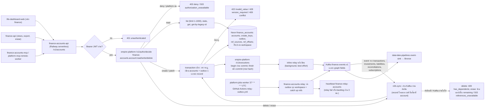

# 01 — Business process (As-Is / To-Be)

finance-accounts-api (cell `finance-accounts`) คือรายการเดียวของที่เก็บหรือค้างเงิน (bank, cash, wallet, payment, credit, investment, receivable) ต่อ workspace; finance cell อื่นชี้มาที่ account ด้วย `account_id` และ owner ใช้ผ่าน `life-dashboard-web`, `finance-api` และ MCP

Last reviewed: 2026-11-27 · commit `1a5c7fb`

## As-Is (จากโค้ดวันนี้)

Sources: `cell.yaml`, `pyproject.toml` (platform-cellkit v1.1.1: `cellkit/app.py`, `cellkit/refs.py`, `cellkit/relay.py`, `cellkit/gateway.py`), `migrations/0001_finance_accounts.sql`–`0004_cross_references.sql`, `.github/workflows/relay-outbox.yml`, `.railway/railway.ts`, `README.md`, `PRODUCT.md`, `specs/006-cross-service-references/spec.md`

ข้อเท็จจริงสำคัญจากโค้ด:

- โค้ดของ cell มีแค่ `cell.yaml`; route, auth, outbox, refs และ relay มาจาก platform-cellkit v1.1.1 (`src/solo_finance_accounts/` ว่าง)
- กฎ: `name` ไม่ซ้ำภายใน `scope` (409) และไม่เกิน 200 ตัว; `account_type`, `status` เป็น enum; `closed_on` ต้องไม่ก่อน `opened_on` (422 `invalid_value`); `currency` ISO 4217 ค่าเริ่มต้น THB; PATCH ที่ส่ง `opening_balance` ต้องมี `expected_version` (428, SPEC-009)
- `referenced_by`: `transactions.transaction`, `investments.investment`, `liabilities.liability`, `reconciliations.reconciliation`, `subscriptions.subscription` (`account_id`); account ที่ยังถูกชี้ลบไม่ได้ ให้ปิด (`status = closed`) แทน; cell ที่ชี้มาจะปฏิเสธการเขียน `account_id` ที่ปิดแล้ว (422 `reference_closed`)
- event `finance-accounts.account.created/updated/deleted` มีเฉพาะ `account_type`, `scope`, `currency`, `status`, `opened_on`, `closed_on` (ไม่มี `opening_balance`, ชื่อ, institution หรือ notes); migration 0004 ส่ง `snapshot` ของ row เดิมหนึ่งครั้ง
- `POST /v1/accounts/erase` ต้องมี `confirm` = workspace ของผู้เรียก ลบทีละ 1-500 แถว (ค่าเริ่มต้น 200; SPEC-008)
- `/health` คืน commit ที่ deploy (`RAILWAY_GIT_COMMIT_SHA`); cell นี้เป็น CD pilot (`docs/runbooks/cd-pilot.md`)
- การตรวจ `X-Gateway-Assertion` (off/report/enforce), inline relay และ `FINANCE_ACCOUNTS_REFS_DATABASE_URL` ขึ้นกับตัวแปรบน Railway [ต้องยืนยัน: ค่าใน production]

## To-Be (จาก `PRODUCT.md` §Measures และ `specs/004-identity-issuer-trust/spec.md`)

- `specs/004-identity-issuer-trust/spec.md`: cell เชื่อ token ของ platform-identity เคียงข้าง empire-platform; โค้ดอยู่ใน kit แล้ว แต่ "production activation needs a separate owner go"
- `PRODUCT.md` §Measures: account ที่มี transaction ใน 90 วันล่าสุด, `account_id` ที่ cell อื่นหาไม่เจอ (เป้า 0), 5xx และ p95 latency ของ `/v1/accounts`
- `PRODUCT.md` §Capabilities: out of scope = ยอดคงเหลือตามเวลา (คำนวณจาก `finance-transactions-api`), การเชื่อมธนาคาร และการจ่ายเงิน

## Gap

| ID | As-Is → To-Be | Status | Owner | Evidence |
|---|---|---|---|---|
| G1 | รับ token ของ platform-identity ได้ในโค้ด แต่ยังไม่ยืนยันว่าเปิดใน production → owner ตัดสินเปิดใช้ (ตั้ง `FINANCE_ACCOUNTS_JWT_IDENTITY_*`) | decide | owner | `specs/004-identity-issuer-trust/spec.md` (Status) |
| G2 | ไม่มีอะไรเก็บ Measures (account ที่มี transaction 90 วัน, `account_id` ที่หาไม่เจอ) → เก็บและรายงานตาม `PRODUCT.md` | todo | claude | `PRODUCT.md` §Measures; ไม่มีตัวเก็บใน repo |

## Open questions

- `PRODUCT.md` §Capabilities ยังเขียนว่าการลบ account ที่ถูกชี้เป็นหน้าที่ผู้เรียก แต่โค้ดวันนี้ (SPEC-006) ปฏิเสธด้วย 409 `has_dependents`; ควรแก้ `PRODUCT.md`
- `PRODUCT.md` §Users ไม่ได้ระบุ `finance-api` ทั้งที่ `finance-api/src/finance_api/app.py` (`SOURCES`) อ่าน `/v1/accounts`
- โหมด gateway assertion และ signed events (`FINANCE_ACCOUNTS_EVENT_SIGNATURES`) ใน production เป็นค่าใด
